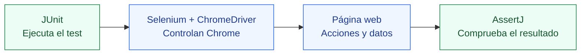
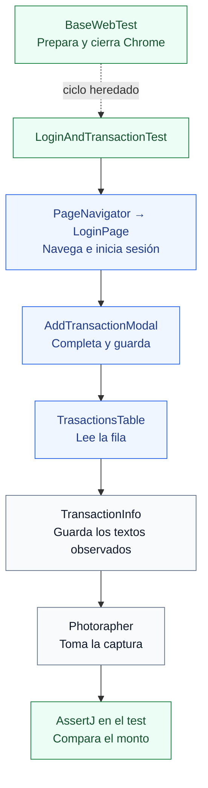

<a id="inicio"></a>

<div align="center">

<p><strong>APRENDE · AUTOMATIZA · COMPRUEBA</strong></p>
<h1>seleniumBasic</h1>
<p><strong>Tu guía de automatización, desde el primer clic.</strong><br>Java, Selenium y Maven en Eclipse · Windows + Chrome</p>

<p>


</p>

<p><a href="#crear-proyecto">Crear desde cero</a> · <a href="#estructura">Explorar el proyecto</a> · <a href="#ejecutar">Ejecutar un test</a> · <a href="#problemas">Resolver un error</a></p>
<p><sub>20 capítulos · Ejemplos explicados · Configuración real · Lectura desplegable</sub></p>

</div>

---

<a id="mapa"></a>

<details>
<summary><strong>🗺️ Elige tu ruta · mapa de la guía</strong></summary>

No necesitas leer todo de una vez. Elige una ruta y abre el capítulo que necesites; los subtemas también se despliegan por separado. Los enlaces te llevan al capítulo: pulsa su título para abrirlo.

| Si hoy quieres… | Empieza aquí | Continúa con… |
| --- | --- | --- |
| **Aprender desde cero** | [01 · Selenium](#selenium) | [03 · Windows](#windows) → [05 · Proyecto](#crear-proyecto) → [11 · Primer test](#primer-test) |
| **Entender este repositorio** | [08 · Estructura](#estructura) | [09 · Clases](#clases) → [15 · Page Objects](#page-objects) |
| **Preparar Eclipse** | [02 · Entorno](#entorno) | [04 · Eclipse](#eclipse) → [07 · Importar](#importar) |
| **Correr o reparar un test** | [17 · Ejecutar](#ejecutar) | [13 · Esperas](#esperas) → [14 · Aserciones](#aserciones) → [19 · Problemas](#problemas) |

**El recorrido completo**

| 🧭 Ubícate | 🛠️ Prepara tu espacio | 🧩 Entiende y practica | 🚀 Ejecuta y mejora |
| --- | --- | --- | --- |
| [01 · Selenium](#selenium) | [03 · Windows](#windows) | [08 · Estructura](#estructura) | [17 · Ejecutar](#ejecutar) |
| [02 · Entorno](#entorno) | [04 · Eclipse](#eclipse) | [09 · Clases](#clases) | [18 · Historial](#historial) |
| | [05 · Proyecto nuevo](#crear-proyecto) | [10 · Java básico](#java) | [19 · Problemas](#problemas) |
| | [06 · pom.xml](#pom) | [11 · Primer test](#primer-test) | [20 · Aprendizaje](#aprendizaje) |
| | [07 · Importar](#importar) | [12 · Localizadores](#localizadores) | |
| | | [13 · Esperas](#esperas) | |
| | | [14 · Aserciones](#aserciones) | |
| | | [15 · Page Objects](#page-objects) | |
| | | [16 · Interacciones](#interacciones) | |

> **Cómo aprovechar cada capítulo**<br>
> Lee su objetivo, abre el subtema que necesitas y termina con la pregunta de práctica. Los ejemplos completos y los fragmentos didácticos se identifican en su explicación.

**Sobre esta guía.** Documentación preparada el **12 de octubre de 2026**, a partir del código, configuraciones locales y chats anteriores. Las etiquetas muestran versiones verificadas; Java 17 es el objetivo del proyecto, mientras que el JDK de terminal es 25.0.4.1. Los ejemplos de mejora no implican cambios ya aplicados al código.

</details>

---
<p><strong>🧭 01 / UBÍCATE</strong><br><sub>Herramientas, versiones y una base clara antes de empezar.</sub></p>

<a id="selenium"></a>

<details>
<summary><strong>01 · Introducción a Selenium</strong></summary>

> **Al terminar este capítulo**<br>
> Entender quién hace qué cuando una prueba controla Chrome.

Selenium permite controlar un navegador mediante código: abrir una página, localizar campos, escribir, hacer clic y leer resultados. Aquí usamos **Selenium WebDriver con Java y Chrome**.

Una prueba combina preparación, acciones y verificación. Abrir una página demuestra que la navegación se ejecutó; una **aserción** comprueba que se obtuvo lo esperado. Después de guardar una transacción, por ejemplo, comparamos el monto leído de la tabla con el monto enviado.

<details>
<summary><strong>Herramientas y responsabilidades</strong></summary>

| Herramienta | Qué hace | Ejemplo |
| --- | --- | --- |
| Java | Lenguaje del código | Clases y métodos `.java` |
| JDK | Compila y ejecuta Java | `javac`, `java` |
| Eclipse | IDE para editar y ejecutar | Project Explorer, editor y Console |
| Maven | Descarga bibliotecas y organiza el build | `pom.xml`, `mvn test` |
| Selenium WebDriver | API para controlar el navegador | `driver.get(...)` |
| ChromeDriver | Comunica Selenium con Chrome | `new ChromeDriver()` |
| Chrome | Navegador donde ocurren las acciones | Ventana de prueba |
| JUnit Jupiter | Reconoce y ejecuta pruebas | `@Test` |
| AssertJ | Compara resultados | `assertThat(...).isEqualTo(...)` |
| Page Objects | Organizan acciones por pantalla/componente | `LoginPage` |



Maven prepara el proyecto; Eclipse permite trabajar visualmente. Un plugin del IDE ayuda a escribir/revisar código, pero no sustituye una dependencia Maven.

</details>

<details>
<summary><strong>WebDriver, Selenium IDE y Grid</strong></summary>

WebDriver es la herramienta usada aquí para escribir automatización. Selenium IDE se orienta a grabar/reproducir acciones y Grid a distribuir sesiones. Este proyecto utiliza WebDriver local; no contiene configuración Grid ni grabaciones de Selenium IDE.

</details>


> **Ponlo en práctica** · Explica con tus palabras la diferencia entre Selenium, ChromeDriver y JUnit.

[↑ Volver al mapa](#mapa)

</details>

---


<a id="entorno"></a>

<details>
<summary><strong>02 · Tu entorno, en detalle</strong></summary>

> **Al terminar este capítulo**<br>
> Reconocer las versiones instaladas y distinguir Java del IDE, de Maven y del proyecto.

<details>
<summary><strong>Inventario actual</strong></summary>

| Componente | Valor observado | Evidencia |
| --- | --- | --- |
| Sistema | Windows 11, amd64 | `mvn -version` |
| Eclipse | Java 2026-09, plataforma 4.41.0 | `eclipse.ini` y plugins |
| Java en terminal | Temurin OpenJDK `25.0.4.1+1` | `java -version` |
| Maven en terminal | Apache Maven `3.10.0` | `mvn -version` |
| Nivel Java del proyecto | `17` | pom, classpath y preferencias JDT |
| Codificación | UTF-8 | pom y preferencias del proyecto |
| Selenium | `4.50.0` | `selenium-java` en pom |
| JUnit Jupiter | `5.10.0` | BOM de JUnit |
| JUnit antiguo | `3.8.1` | `junit:junit` en pom |
| AssertJ | `3.27.7` | `assertj-core` en pom |
| m2e core | `2.8.0.20260815-0704` | Plugin de Eclipse |
| EclEmma | `3.1.12.202609021052` | Plugins de cobertura |
| SonarQube for IDE | `13.0.0.84907` | Plugins `org.sonarlint.eclipse.*` |
| Checkstyle | `13.9.0.202608040232` | Plugin `net.sf.eclipsecs.checkstyle` |
| Codeium/Windsurf | `1.0.0.202503260050` | Plugin `com.codeium.eclipse.plugin` |

La versión exacta de Chrome no se registró. Consúltala en **Chrome → Ayuda → Información de Google Chrome**.

```text
Proyecto:
C:\Users\ismae\Desktop\Projects\seleniumBasic

Eclipse:
C:\Users\ismae\eclipse\java-2026-09\eclipse

JDK usado por la terminal:
D:\Workspace selenium\OpenJDK25U-jdk_x64_windows_hotspot_25.0.4.1_1\jdk-25.0.4.1+1

Maven usado por la terminal:
D:\Workspace selenium\apache-maven-3.10.0

Aplicaciones HTML externas:
D:\Workspace selenium\mini-web-apps\mini-web-apps

Preferencias del workspace inspeccionado:
C:\Users\ismae\Desktop\.metadata\.plugins\org.eclipse.core.runtime\.settings
```

En otra computadora debes adaptar estas rutas a tus instalaciones.

</details>

<details>
<summary><strong>Java 25 instalado frente a Java 17 del proyecto</strong></summary>

Existen tres configuraciones:

1. **Java que inicia Eclipse:** `eclipse.ini` usa el runtime JustJ 25.0.4 de su instalación y declara `osgi.requiredJavaVersion=25`.
2. **Java que usa Maven de terminal:** `mvn -version` indica Temurin 25.0.4.1 en `D:`.
3. **Nivel del proyecto:** Maven declara `source=17` y `target=17`; Eclipse muestra `JavaSE-17` y compliance 17.

`JavaSE-17` no demuestra que haya un JDK 17 instalado. Un JDK posterior puede compilar código con esos niveles. Las preferencias del workspace registran como VM predeterminada el runtime JustJ de Eclipse.

`source` limita sintaxis y `target` fija bytecode; no restringen todas las APIs del JDK nuevo. `maven.compiler.release` permite restringir también las APIs de una versión objetivo. El pom actual conserva source/target.

No cambies el Java que inicia este Eclipse a 17: su configuración requiere 25. Puedes seleccionar un JDK diferente para un proyecto o ejecución sin sustituir el runtime que inicia el IDE.

</details>

<details>
<summary><strong>Confirmado, histórico y pendiente</strong></summary>

Los archivos instalados y los chats confirman las versiones de plugins. Eso no comprueba que Checkstyle esté activado en cada proyecto ni que exista conexión de SonarQube a un servidor.

El último estado recuperado de Codeium era **Not logged into Codeium**. No se verificó una sesión actual.

Existen reportes previos de dos métodos con cero fallos, pero no equivalen a ejecutar toda la suite actual. Para crear este README se leyeron archivos y configuraciones; no se ejecutaron tests ni se cambiaron ajustes.

</details>


> **Ponlo en práctica** · Compara java -version y mvn -version con el nivel JavaSE-17 del proyecto.

[↑ Volver al mapa](#mapa)

</details>

---


<p><strong>🛠️ 02 / PREPARA TU ESPACIO</strong><br><sub>De Windows al proyecto abierto en Eclipse.</sub></p>

<a id="windows"></a>

<details>
<summary><strong>03 · Prepara Windows</strong></summary>

> **Al terminar este capítulo**<br>
> Dejar Java, Chrome y Maven disponibles para trabajar.

<details>
<summary><strong>3.1 Instalar un JDK y configurar JAVA_HOME</strong></summary>

1. Descarga un JDK para Windows x64 desde [Eclipse Temurin](https://adoptium.net/temurin/releases/). Para reproducir el entorno observado, se utilizó Temurin 25.0.4.1.
2. Instálalo o descomprime la distribución en una carpeta conocida.
3. Ubica su raíz: debe contener `bin`, y dentro `java.exe` y `javac.exe`.
4. Busca en Windows **Editar las variables de entorno de esta cuenta**.
5. Crea `JAVA_HOME` con la raíz del JDK, sin `\bin`.
6. Edita `Path`, pulsa **Nuevo** y añade `%JAVA_HOME%\bin`; conserva las demás entradas.
7. Cierra y abre PowerShell para tomar los cambios.
8. Ejecuta:

```powershell
java -version
javac -version
$env:JAVA_HOME
Get-Command java
```

`java` ejecuta; `javac` compila. Si solo funciona java, revisa si seleccionaste un runtime sin herramientas o si Path apunta a otra instalación.

Ejemplo de JAVA_HOME de este equipo:

```text
D:\Workspace selenium\OpenJDK25U-jdk_x64_windows_hotspot_25.0.4.1_1\jdk-25.0.4.1+1
```

</details>

<details>
<summary><strong>3.2 Chrome y ChromeDriver</strong></summary>

Instala Chrome y comprueba que abre. Chrome es el navegador; ChromeDriver es el ejecutable que lo controla.

El proyecto crea `new ChromeDriver()` sin fijar una ruta manual. Selenium Manager puede resolver el driver cuando no se proporciona otro; la primera resolución puede requerir internet. Revisa también drivers existentes en Path/caché. No hay una dependencia WebDriverManager en este pom. [Selenium Manager](https://www.selenium.dev/documentation/selenium_manager/).

</details>

<details>
<summary><strong>3.3 Instalar Maven para PowerShell</strong></summary>

1. Descarga el ZIP binario de [Apache Maven](https://maven.apache.org/download.cgi).
2. Descomprímelo. La instalación verificada está en `D:\Workspace selenium\apache-maven-3.10.0`.
3. Añade su carpeta `bin` a Path.
4. Abre una nueva terminal y ejecuta:

```powershell
mvn -version
Get-Command mvn
```

Revisa versión, Maven home y Java usado. Si usa otro Java, revisa JAVA_HOME/Path. `MAVEN_HOME` no es necesario para estos comandos. Las dependencias normalmente quedan en `%USERPROFILE%\.m2\repository`, fuera del proyecto. [Instalación oficial](https://maven.apache.org/install.html).

</details>

<details>
<summary><strong>3.4 Maven de terminal y Maven de Eclipse</strong></summary>

m2e integra Maven en Eclipse y puede usar un runtime embebido. Ver **Run As → Maven test** no garantiza que `mvn` funcione en PowerShell.

Revisa **Window → Preferences → Maven → Installations**. Para agregar Maven externo: **Add…**, selecciona su raíz y confirma. En una ejecución, revisa **Run Configurations… → Maven Build → Maven Runtime** y la pestaña **JRE**.

Los chats antiguos indicaban Java/Maven fuera de Path. La revisión actual sí encontró ambos: las notas describen momentos distintos.

</details>


> **Ponlo en práctica** · Abre una terminal nueva y comprueba java, javac y mvn.

[↑ Volver al mapa](#mapa)

</details>

---


<a id="eclipse"></a>

<details>
<summary><strong>04 · Eclipse a tu medida</strong></summary>

> **Al terminar este capítulo**<br>
> Encontrar tus herramientas, configurar el editor y reconocer los plugins instalados.

<details>
<summary><strong>4.1 Instalar Eclipse y reconocer el workspace</strong></summary>

Para un equipo nuevo selecciona **Eclipse IDE for Java Developers** desde [Eclipse Packages](https://www.eclipse.org/downloads/packages/). Aquí se verificó el paquete 2026-09.

El workspace guarda preferencias y proyectos importados en `.metadata`; el proyecto puede vivir en otra carpeta. El workspace inspeccionado tiene preferencias en `Desktop\.metadata`, mientras que el código está en `Desktop\Projects\seleniumBasic`.

| Vista | Acceso | Uso |
| --- | --- | --- |
| Project Explorer | Window → Show View → Project Explorer | Carpetas y archivos |
| Console | Window → Show View → Console | Salida de Java/Maven |
| Problems | Window → Show View → Problems | Errores y avisos |
| JUnit | Show View → Other… → Java → JUnit | Tests y Failure Trace |
| Coverage | Show View → Other… → Java → Coverage | Cobertura EclEmma |

Busca en **Show View → Other…** si una vista no aparece directamente.

</details>

<details>
<summary><strong>4.2 Registrar Java para un proyecto</strong></summary>

1. **Window → Preferences → Java → Installed JREs**.
2. **Add… → Standard VM → Next**.
3. En JRE home selecciona la raíz del JDK; el diálogo usa el nombre JRE aunque selecciones un JDK.
4. Confirma y selecciona la VM predeterminada adecuada.
5. Revisa **Java → Installed JREs → Execution Environments → JavaSE-17** y su VM asociada. Un JDK 17 permite usar directamente ese entorno; si seleccionas uno posterior, revisa compatibilidad y avisos del IDE.
6. Proyecto → **Properties → Java Build Path → Libraries**: comprueba su entrada Java.
7. **Properties → Java Compiler**: comprueba compliance 17.
8. Para cambios en el pom, utiliza **Maven → Update Project…**.

Estos pasos sirven para una instalación nueva; no se aplicaron al redactar el README.

</details>

<details>
<summary><strong>4.3 Árbol físico de carpetas y archivos ocultos</strong></summary>

En el chat de creación ajustamos Project Explorer para mostrar carpetas como en el ejemplo del curso:

1. Abre **Project Explorer** y su menú de tres puntos/flecha.
2. **Filters and Customization…**.
3. En **Content**, desmarca **Java Elements** para ver carpetas físicas.
4. En **Pre-set filters**, desmarca **`.* resources`** para ver archivos ocultos.
5. Expande `seleniumBasic → src → test → java`.

Package Explorer puede mostrar `src/test/java` como una sola raíz fuente y paquetes con puntos. Cambia la representación, no los archivos. Usa **F5** sobre el proyecto para refrescar cambios hechos fuera del IDE.

</details>

<details>
<summary><strong>4.4 Save Actions: formato e imports al guardar</strong></summary>

Configuramos acciones integradas de Eclipse:

1. **Window → Preferences → Java → Editor → Save Actions**.
2. Activa **Perform the selected actions on save**.
3. Activa **Format source code → Format edited lines**.
4. Activa **Organize imports**.
5. **Apply and Close**.

El historial confirma formato de líneas editadas y organización de imports; las preferencias revisadas muestran activo el participante de limpieza al guardar. El perfil se revisa en **Java → Code Style → Formatter**. [Save Actions oficiales](https://help.eclipse.org/latest/topic/org.eclipse.jdt.doc.user/reference/preferences/java/editor/ref-preferences-save-actions.htm).

| Atajo | Uso |
| --- | --- |
| Ctrl+S | Guardar |
| Ctrl+Espacio | Sugerencias Java |
| Ctrl+Shift+O | Organizar imports |
| Ctrl+Shift+F | Formatear |
| Ctrl+1 | Correcciones rápidas |
| F3 | Ir a una declaración |
| F5 sobre proyecto | Refrescar desde disco |
| Alt+F5 | Maven Update Project |

Guardar Java puede activar esas acciones y cambiar formato/imports.

</details>

<details>
<summary><strong>4.5 SonarQube for IDE</strong></summary>

Instalamos **SonarQube for IDE 13.0**; sus plugins conservan nombres `org.sonarlint.eclipse`. Ayuda a detectar problemas de código al editar. No agrega Selenium ni cambia el runner JUnit.

Comprueba **Help → About Eclipse IDE → Installation Details**. En el historial se instaló desde Marketplace y se reinició. Para reproducirlo consulta [las instrucciones oficiales](https://docs.sonarsource.com/sonarqube-for-eclipse/getting-started/installation). No se encontró configuración de conexión con un servidor dentro del repositorio.

</details>

<details>
<summary><strong>4.6 Checkstyle</strong></summary>

Instalamos **Checkstyle Plug-in 13.9.0**. El formateador cambia formato; Checkstyle señala incumplimientos de las reglas elegidas.

Revisa Installation Details y busca Checkstyle en **Window → Preferences** y **Properties** del proyecto. Estar instalado no demuestra análisis activo en este proyecto. No existe un archivo propio de reglas Checkstyle aquí. [Eclipse Checkstyle Plugin](https://checkstyle.org/eclipse-cs/).

</details>

<details>
<summary><strong>4.7 Codeium/Windsurf</strong></summary>

El chat archivado confirma instalación de **Codeium/Windsurf 1.0.0.202503260050** y reinicio. El archivo del plugin continúa presente.

El Marketplace no lo mostró entonces y se utilizó un sitio de actualización de Exafunction. El último estado registrado era **Not logged into Codeium**; el intento posterior de abrir acceso se interrumpió. No se confirmó que la sesión quedara iniciada.

Para usar la instalación existente, busca su indicador/menú Codeium, elige iniciar sesión, completa el acceso en el navegador y verifica el estado en Eclipse. Revisa sus atajos en **Preferences → General → Keys** buscando Codeium.

La documentación actual clasifica Eclipse entre los plugins antiguos en mantenimiento. Esta guía registra lo instalado sin garantizar planes gratuitos, límites ni una reinstalación idéntica. [Windsurf Plugins](https://docs.devin.ai/windsurf/plugins/getting-started).

</details>

<details>
<summary><strong>4.8 Qué ya estaba disponible y cómo revisar plugins</strong></summary>

Según los chats, Eclipse ya incluía Maven, JUnit, Git y cobertura. No instalamos material icons/tema ni Copilot en aquel trabajo. TestNG no aparece entre las dependencias.

Revisa **Help → About Eclipse IDE → Installation Details → Installed Software / Plug-ins**. Para instalar en otro equipo usa **Help → Eclipse Marketplace…** o **Help → Install New Software…** con el sitio oficial vigente del fabricante. Revisa el proveedor mostrado en avisos de confianza y reinicia cuando lo solicite el IDE.

</details>


> **Ponlo en práctica** · Localiza Save Actions, Project Explorer y la vista JUnit.

[↑ Volver al mapa](#mapa)

</details>

---


<a id="crear-proyecto"></a>

<details>
<summary><strong>05 · Tu proyecto desde cero</strong></summary>

> **Al terminar este capítulo**<br>
> Crear la estructura Maven y agregar Selenium desde el manifiesto.

<details>
<summary><strong>5.1 Asistente Maven de Eclipse paso a paso</strong></summary>

Haz el ejercicio en una carpeta nueva si este proyecto ya existe.

1. **File → New → Other…**.
2. Busca `Maven` y selecciona **Maven → Maven Project → Next**.
3. Marca **Create a simple project (skip archetype selection)**.
4. Para elegir una carpeta concreta, desmarca **Use default Workspace location** y selecciona una ubicación nueva.
5. Pulsa **Next**.
6. Completa los campos:

| Campo | Valor para reproducir la identidad actual |
| --- | --- |
| Group Id | `com.seleniumBasic` |
| Artifact Id | `seleniumBasic` |
| Version | `0.0.1-SNAPSHOT` |
| Packaging | `jar` |
| Name | `seleniumBasic` |

7. Pulsa **Finish** y espera la creación.
8. Abre `pom.xml`. Si aparece un editor visual, elige su pestaña **pom.xml** para ver el XML.
9. Usa el manifiesto de la sección 6 como referencia de Java y dependencias.
10. Guarda con Ctrl+S.
11. Clic derecho sobre proyecto → **Maven → Update Project…**; selecciónalo y confirma.
12. Revisa **Maven Dependencies** y **Problems**.

Group Id identifica el grupo Maven y Artifact Id el artefacto. No obligan a usar ese mismo texto como paquete Java: aquí el grupo conserva `com.seleniumBasic`, mientras las clases actuales usan `com.seleniumbasic`.

</details>

<details>
<summary><strong>5.2 Proyecto simple frente al archetype original</strong></summary>

El historial indica que la creación Maven ya estaba iniciada y se confirmó con `Y`. La plantilla original incluyó `App.java` y `AppTest.java` con JUnit 3.

Si desmarcas **Create a simple project**, puedes seleccionar un archetype como `maven-archetype-quickstart`. Sus archivos y JUnit dependen de la versión elegida; no todas generan la misma estructura inicial.

El camino simple evita depender de esa plantilla. Si faltan carpetas fuente, usa **New → Source Folder** y crea:

```text
src/main/java
src/main/resources
src/test/java
src/test/resources
```

El proyecto simple no necesariamente crea una aplicación Hello World. No necesitas un método main para ejecutar una prueba JUnit.

</details>

<details>
<summary><strong>5.3 Instalar Selenium mediante Maven</strong></summary>

En Java, declaramos `org.seleniumhq.selenium:selenium-java:4.50.0` en el pom. Maven descarga los JAR y dependencias transitivas; Eclipse los muestra en **Maven Dependencies**. Guarda y actualiza Maven. No añadas manualmente los mismos JAR al Build Path, porque duplicarías la administración de bibliotecas. [Instalación de Selenium Java](https://www.selenium.dev/documentation/webdriver/getting_started/install_library/).

</details>


> **Ponlo en práctica** · En una carpeta de práctica, identifica Group Id, Artifact Id y la raíz de fuentes.

[↑ Volver al mapa](#mapa)

</details>

---


<a id="pom"></a>

<details>
<summary><strong>06 · Lee el pom.xml sin perderte</strong></summary>

> **Al terminar este capítulo**<br>
> Entender dependencias, versiones, scopes y fases de Maven.

<details>
<summary><strong>6.1 Manifiesto completo leído del proyecto</strong></summary>

```xml
<project xmlns="http://maven.apache.org/POM/4.0.0"
	xmlns:xsi="http://www.w3.org/2001/XMLSchema-instance"
	xsi:schemaLocation="http://maven.apache.org/POM/4.0.0 http://maven.apache.org/xsd/maven-4.0.0.xsd">
	<modelVersion>4.0.0</modelVersion>

	<groupId>com.seleniumBasic</groupId>
	<artifactId>seleniumBasic</artifactId>
	<version>0.0.1-SNAPSHOT</version>
	<packaging>jar</packaging>

	<name>seleniumBasic</name>
	<url>http://maven.apache.org</url>

	<properties>
		<project.build.sourceEncoding>UTF-8</project.build.sourceEncoding>
		<maven.compiler.source>17</maven.compiler.source>
		<maven.compiler.target>17</maven.compiler.target>
	</properties>

	<dependencyManagement>
		<dependencies>
			<dependency>
				<groupId>org.junit</groupId>
				<artifactId>junit-bom</artifactId>
				<version>5.10.0</version>
				<type>pom</type>
				<scope>import</scope>
			</dependency>
		</dependencies>
	</dependencyManagement>

	<dependencies>
		<dependency>
			<groupId>org.junit.jupiter</groupId>
			<artifactId>junit-jupiter</artifactId>
			<scope>test</scope>
		</dependency>
		<dependency>
			<groupId>org.seleniumhq.selenium</groupId>
			<artifactId>selenium-java</artifactId>
			<version>4.50.0</version>
		</dependency>
		<!-- Source: https://mvnrepository.com/artifact/org.assertj/assertj-core -->
		<dependency>
			<groupId>org.assertj</groupId>
			<artifactId>assertj-core</artifactId>
			<version>3.27.7</version>
			<scope>test</scope>
		</dependency>
		<dependency>
			<groupId>junit</groupId>
			<artifactId>junit</artifactId>
			<version>3.8.1</version>
			<scope>test</scope>
		</dependency>
	</dependencies>
</project>
```

</details>

<details>
<summary><strong>6.2 Explicación de cada bloque</strong></summary>

| Bloque | Significado |
| --- | --- |
| `project` y atributos XML | Documento Maven y esquema |
| `modelVersion` | Modelo POM `4.0.0`; no es la versión del Maven instalado |
| `groupId` | Grupo `com.seleniumBasic` |
| `artifactId` | Artefacto `seleniumBasic` |
| `version` | `0.0.1-SNAPSHOT`: versión de desarrollo |
| `packaging` | `jar`: formato de empaquetado |
| `name` | Nombre legible |
| `url` | URL Maven de la plantilla; no es la web que prueba Selenium |
| `project.build.sourceEncoding` | UTF-8 |
| `maven.compiler.source` | Sintaxis Java 17 |
| `maven.compiler.target` | Bytecode para Java 17 |
| `dependencyManagement` | Administra versiones; no agrega por sí solo bibliotecas |
| `junit-bom` | Alinea componentes JUnit en 5.10.0 |
| `type=pom`, `scope=import` | Importan administración de versiones del BOM |
| `dependencies` | Bibliotecas usadas |
| `scope=test` | Dependencia disponible para pruebas |
| Selenium sin scope | Utiliza el scope predeterminado compile |

Jupiter recibe su versión del BOM. AssertJ facilita comparaciones. JUnit 3.8.1 mantiene compilable la prueba antigua que extiende TestCase.

El pom no declara build ni versiones de plugins. Maven los resuelve mediante su configuración efectiva. Encontrar una versión en `.m2` no prueba que el proyecto la tenga fijada.

</details>

<details>
<summary><strong>6.3 Compilar, ejecutar y empaquetar</strong></summary>

```text
compile: compila src/main/java
    → test-compile: compila src/test/java
    → test: ejecuta pruebas descubiertas
    → package: genera artefacto empaquetado
```

Maven Compiler Plugin compila; Maven Surefire Plugin ejecuta pruebas de la fase test. Puedes consultar, sin editar el pom:

```powershell
mvn help:effective-pom
mvn dependency:tree
```

En un proyecto nuevo puedes fijar un Surefire compatible con JUnit Platform. Este bloque es un ejemplo adicional; no está en el pom actual:

```xml
<build>
    <plugins>
        <plugin>
            <groupId>org.apache.maven.plugins</groupId>
            <artifactId>maven-surefire-plugin</artifactId>
            <version>3.5.4</version>
        </plugin>
    </plugins>
</build>
```

JUnit 3 y Jupiter tienen descubrimiento distinto. La dependencia JUnit 3 sola no garantiza que su clase antigua sea descubierta por un runner JUnit Platform. Revisa los nombres/cantidades ejecutados.

</details>


> **Ponlo en práctica** · Encuentra de dónde obtiene Jupiter su versión y qué dependencias usan scope test.

[↑ Volver al mapa](#mapa)

</details>

---


<a id="importar"></a>

<details>
<summary><strong>07 · Abre el proyecto real</strong></summary>

> **Al terminar este capítulo**<br>
> Importar la carpeta correcta y localizar los HTML de práctica.

<details>
<summary><strong>7.1 Importar en Eclipse</strong></summary>

1. **File → Import… → Maven → Existing Maven Projects → Next**.
2. Root Directory: `C:\Users\ismae\Desktop\Projects\seleniumBasic`.
3. Marca el pom encontrado y pulsa Finish.
4. Espera descargas/build.
5. Proyecto → **Maven → Update Project…**.
6. Revisa Java, Maven Dependencies y Problems.

Si ya existe un proyecto con ese nombre, revisa **Properties → Resource → Location** antes de importar otra copia. Históricamente hubo confusión con `Desktop\Selenium-Basic`; esta guía documenta `Desktop\Projects\seleniumBasic`.

</details>

<details>
<summary><strong>7.2 HTML de práctica fuera del repositorio</strong></summary>

| Página | Ruta usada por el código | Uso |
| --- | --- | --- |
| Registro | `D:\Workspace selenium\mini-web-apps\mini-web-apps\registration\register.html` | Formulario/resumen |
| Login | `D:\Workspace selenium\mini-web-apps\mini-web-apps\login\login.html` | Credenciales de práctica user / pass |
| Transacciones | `login\transactions.html`, junto al login | Página tras el acceso |
| Esperas | `D:\Workspace selenium\mini-web-apps\mini-web-apps\esperas.html` | Mensaje tras pulsar botón |

Registro, login y esperas existían al revisar el equipo. El login carga jQuery de un CDN y redirige a transactions.html. Copiar solo login.html no reproduce la aplicación; conserva sus archivos relacionados y acceso a sus recursos externos.

Abre manualmente el HTML en Chrome antes de automatizar. Para una ruta con espacios puedes construir la URL así:

```java
File page = new File("D:\\Workspace selenium\\mini-web-apps\\mini-web-apps\\login\\login.html");
driver.get(page.toURI().toString());
```

Las URLs usan `/`; un literal Java representa una barra invertida mediante `\\`. File.toURI evita escribir a mano la URL con `%20`.

En otro equipo los tests seguirán buscando en D: hasta adaptar sus rutas en un trabajo posterior. Esta guía no cambió ese código.

</details>


> **Ponlo en práctica** · Comprueba la ubicación del proyecto y abre manualmente login.html en Chrome.

[↑ Volver al mapa](#mapa)

</details>

---


<p><strong>🧩 03 / ENTIENDE Y PRACTICA</strong><br><sub>Del mapa de carpetas a una transacción con Page Objects.</sub></p>

<a id="estructura"></a>

<details>
<summary><strong>08 · El mapa del proyecto</strong></summary>

> **Al terminar este capítulo**<br>
> Saber qué guardar, qué se genera y dónde vive cada tipo de archivo.

<details>
<summary><strong>8.1 Árbol actual</strong></summary>

```text
seleniumBasic/
├── README.md
├── pom.xml
├── .gitignore
├── .git/
├── .project
├── .classpath
├── .settings/
│   ├── org.eclipse.core.resources.prefs
│   ├── org.eclipse.jdt.core.prefs
│   └── org.eclipse.m2e.core.prefs
├── .qa/
│   ├── card-draft.md
│   ├── coverage.md
│   ├── execution.md
│   └── project-context.md
├── src/
│   ├── main/java/com/seleniumbasic/
│   │   └── SeleniumBasicApplication.java
│   └── test/
│       ├── java/
│       │   ├── com/seleniumbasic/
│       │   │   ├── SeleniumBasicApplicationTest.java
│       │   │   ├── NavigationTest.java
│       │   │   ├── MercadoLibreSearchTest.java
│       │   │   ├── WaitStrategiesTest.java
│       │   │   └── LoginAndTransactionTest.java
│       │   ├── pageobjects/
│       │   │   ├── base/BaseWebTest.java
│       │   │   ├── login/LoginPage.java
│       │   │   ├── navigation/PageNavigator.java
│       │   │   └── transactions/
│       │   │       ├── AddTransactionModal.java
│       │   │       └── TrasactionsTable.java
│       │   ├── Models/TransactionInfo.java
│       │   ├── Utils/Photorapher.java
│       │   └── resources/wallpaper.png
│       └── resources/screenshots/transactions.png
└── target/
```

src/main/resources aparece como entrada de classpath, pero no se inventarió ningún archivo allí. No hay `.mvn`, `mvnw` ni `mvnw.cmd`.

</details>

<details>
<summary><strong>8.2 Fuentes y recursos</strong></summary>

| Carpeta | Función |
| --- | --- |
| `src/main/java` | Aplicación Hello World |
| `src/test/java` | Tests y clases auxiliares |
| `com/seleniumbasic` | Paquete actual de aplicación/tests |
| `pageobjects/base` | Preparación/cierre compartido |
| `pageobjects/login` | Acciones de acceso |
| `pageobjects/navigation` | Navegación |
| `pageobjects/transactions` | Modal y tabla |
| `Models` | Contenedores de datos; conserva mayúscula en el paquete actual |
| `Utils` | Utilidades; conserva mayúscula en el paquete actual |
| `src/test/java/resources` | Ubicación actual de wallpaper.png |
| `src/test/resources/screenshots` | Destino de capturas; contiene transactions.png |

Maven distingue fuentes principales, pruebas y recursos. Su ubicación convencional de recursos de test es src/test/resources; el proyecto conserva la imagen de carga en src/test/java/resources. [Layout estándar de Maven](https://maven.apache.org/guides/introduction/introduction-to-the-standard-directory-layout.html).

</details>

<details>
<summary><strong>8.3 Raíz, Git y configuración local de Eclipse</strong></summary>

| Archivo/carpeta | Función |
| --- | --- |
| README.md | Esta guía |
| pom.xml | Identidad, Java y dependencias Maven |
| .gitignore | Ignora target/, .settings/, .classpath, .project y .idea/ |
| .git/ | Historial/metadatos internos Git |
| .project | Nombre del proyecto, builders Java/Maven y natures JDT/m2e |
| .classpath | Fuentes, recursos, JavaSE-17, Maven Dependencies y destinos compilados |
| org.eclipse.core.resources.prefs | UTF-8 del proyecto/fuentes |
| org.eclipse.jdt.core.prefs | Compliance/source/target 17 y preview deshabilitado |
| org.eclipse.m2e.core.prefs | Perfiles activos vacíos y resolución de proyectos del workspace |

Los tres prefs están en .settings. Save Actions y plugins pertenecen al workspace/instalación, fuera de esta carpeta local.

.idea es típica de IntelliJ; se ignora, pero no está presente aquí. .gitignore no borra archivos ni impide que Eclipse los use. Si un archivo ya está versionado, añadirlo a ignore no deja de versionarlo automáticamente.

</details>

<details>
<summary><strong>8.4 Documentos históricos .qa</strong></summary>

| Documento | Contenido |
| --- | --- |
| card-draft.md | Borrador de tarjeta de comentarios/aserciones de NavigationTest |
| coverage.md | Requisitos, escenarios y verificaciones |
| execution.md | Evidencia del 7 de octubre de 2026, validación pendiente entonces |
| project-context.md | Inventario y contexto de aquella intervención |

No son código ejecutado por JUnit. Algunos datos ya cambiaron: mencionan paquete/métodos anteriores, ausencia de Git/Page Objects y Java/Maven fuera de Path. Son evidencia histórica; no se editaron para crear esta guía.

</details>

<details>
<summary><strong>8.5 Archivos generados y artefactos de target</strong></summary>

| Elemento | Función |
| --- | --- |
| classes/ | `.class` de aplicación |
| test-classes/ | `.class` de pruebas/auxiliares y copias de recursos |
| generated-sources/ | Fuentes generadas, si existen |
| generated-test-sources/ | Fuentes de test generadas, si existen |
| maven-status/ | Registros de entradas/salidas del compilador |
| surefire-reports/ | TXT/XML de resultados conservados |
| META-INF/MANIFEST.MF | Metadatos generados por build/IDE |
| META-INF/maven/.../pom.xml | Copia de manifiesto del artefacto |
| META-INF/maven/.../pom.properties | Coordenadas generadas |
| createdFiles.lst | Salidas registradas de compilación |
| inputFiles.lst / dependencies.lst | Entradas/dependencias registradas |
| naming-refactor.diff | Artefacto local del cambio histórico de nombres |
| naming-refactor.json | Mapa antes/después y huellas de ese cambio |

No edites `.class` para cambiar una prueba: modifica su fuente `.java`. Las imágenes de target son copias, no sustituyen sus originales.

**mvn clean elimina target**, incluidos reportes y los dos artefactos de refactor conservados allí. Guarda fuera cualquier evidencia que necesites antes de usarlo. target está ignorado por Git.

</details>


> **Ponlo en práctica** · Distingue un archivo fuente, un recurso y un resultado dentro de target.

[↑ Volver al mapa](#mapa)

</details>

---


<a id="clases"></a>

<details>
<summary><strong>09 · Cada clase, explicada</strong></summary>

> **Al terminar este capítulo**<br>
> Reconocer las responsabilidades y el estado actual de los trece archivos Java.

<details>
<summary><strong>9.1 SeleniumBasicApplication.java</strong></summary>

Ubicación: src/main/java/com/seleniumbasic. Contiene main(String[] args), imprime Hello World! y conserva el ejemplo de plantilla. No abre Chrome ni ejecuta tests. Se lanza con **Run As → Java Application**.

</details>

<details>
<summary><strong>9.2 SeleniumBasicApplicationTest.java</strong></summary>

Ubicación: src/test/java/com/seleniumbasic. Extiende junit.framework.TestCase y conserva constructor, suite() y testExampleAssertion() con assertTrue(true). Es estilo JUnit 3 y no abre Chrome. La assertion es trivial, no valida la aplicación. Su descubrimiento junto con Jupiter depende del runner: comprueba el reporte.

</details>

<details>
<summary><strong>9.3 NavigationTest.java</strong></summary>

Ubicación: src/test/java/com/seleniumbasic. Su @BeforeEach crea Chrome y @AfterEach lo cierra. Contadores estáticos imprimen preparaciones/cierres dentro del proceso; no deciden aprobación.

| Método actual | Comportamiento/verificación |
| --- | --- |
| navigateToGoogle | Abre Google; comprueba body visible y título con Google |
| submitRegistrationForm | Llena registro, carga imagen, guarda y cambia al resumen; valida visibilidad, título y nombre/apellido |
| demonstrateAssertJAssertions | Compara strings, nulos y lista; también abre Chrome por el setup de esta clase |
| closeBrowserInFinally | Busca id=no-existe, imprime error y cierra; no navega al formulario antes de buscar y absorbe la excepción |

Registro conserva Thread.sleep(3000) y el índice 1 de handles; no garantiza una elección robusta de pestaña.

</details>

<details>
<summary><strong>9.4 MercadoLibreSearchTest.java</strong></summary>

Ubicación: src/test/java/com/seleniumbasic. searchForProduct crea Chrome, abre Mercado Libre, selecciona México, escribe Play 5 e intenta leer un precio.

No envía Enter ni pulsa búsqueda activa; Keys.ENTER está comentado. El selector de precio contiene un identificador muy específico y puede cambiar. isDisplayed devuelve un valor que no se verifica. El catch solo imprime y puede ocultar un fallo. finally llama quit sin comprobar null.

Es una práctica en construcción; una barra verde no demuestra búsqueda/precio correctos.

</details>

<details>
<summary><strong>9.5 WaitStrategiesTest.java</strong></summary>

Ubicación: src/test/java/com/seleniumbasic. Prepara Chrome y wait de 6 segundos; después lo cierra.

| Método | Estado actual |
| --- | --- |
| readMessageWithoutExplicitWait | Encuentra botón sin pulsarlo; busca inmediatamente el mensaje |
| readMessageWithExplicitWait | Pulsa botón y espera mensaje visible |
| readMessageWithFluentWait | Timeout 10 segundos y consulta cada segundo; tiene errores de selector/excepción |

FluentWait importa **java.util.NoSuchElementException**, pero Selenium lanza **org.openqa.selenium.NoSuchElementException**. El selector escribe **aler-success** en lugar de **alert-success**. Su condición busca presencia, sin exigir visibilidad. Los métodos imprimen textos, sin assertion del mensaje esperado.

</details>

<details>
<summary><strong>9.6 LoginAndTransactionTest.java</strong></summary>

Ubicación: src/test/java/com/seleniumbasic. Hereda BaseWebTest y usa HTML externo.

| Método | Flujo | Verificación actual |
| --- | --- | --- |
| addTransactionWithoutPageObjects | Acceso/modal/guardado con Selenium directo | Sin assertion final |
| logInWithPageObject | Login mediante LoginPage | Sin assertion final del acceso |
| addTransactionWithPageObjects | Navega, accede, guarda, lee fila y captura | Compara solo monto |

El último usa fecha 14/04/24, monto 1000 y descripción Este es un test. Captura transactions.png antes de la assertion. Lee fila 1; no compara fecha/descripción ni comprueba otra fila.

</details>

<details>
<summary><strong>9.7 BaseWebTest.java</strong></summary>

Ubicación: src/test/java/pageobjects/base. Clase abstract que no se instancia directamente; driver, wait y photorapher son protected para las subclases.

@BeforeEach crea ChromeDriver, wait de 10 segundos y Photorapher. @AfterEach comprueba driver != null y hace quit.

Solo LoginAndTransactionTest hereda esta base actualmente. NavigationTest/WaitStrategiesTest tienen su propio ciclo y MercadoLibre usa try/catch/finally.

</details>

<details>
<summary><strong>9.8 LoginPage.java</strong></summary>

Ubicación: src/test/java/pageobjects/login. Guarda By para usuario, contraseña y botón. Constructor recibe el driver existente y crea wait de 10 segundos. login(username,password) espera campos, escribe y pulsa.

No crea otro Chrome. Conserva una consulta isDisplayed cuyo resultado se ignora, seguida de otra espera para clicar; no es una assertion.

</details>

<details>
<summary><strong>9.9 PageNavigator.java</strong></summary>

Ubicación: src/test/java/pageobjects/navigation. Recibe y guarda private final WebDriver driver. navigateToLoginPage(url) llama driver.get(url). Organiza navegación, sin verificar aún el formulario.

</details>

<details>
<summary><strong>9.10 AddTransactionModal.java</strong></summary>

Ubicación: src/test/java/pageobjects/transactions. Guarda cinco localizadores: añadir, fecha, monto, descripción y guardar. Constructor crea wait de 10 segundos; addTransaction abre, completa y guarda.

El atributo driver está declarado pero no inicializado ni utilizado por las acciones actuales, que usan wait. No produce por sí solo el error de entregar null al constructor del wait. Guardar no confirma aparición en tabla: después el test la consulta.

</details>

<details>
<summary><strong>9.11 TrasactionsTable.java</strong></summary>

Ubicación: src/test/java/pageobjects/transactions. **TrasactionsTable** es el nombre actual, con esa ortografía. getTransactionInfoFromRow(rowIndex) espera una fila, lee tres celdas y devuelve TransactionInfo.

```text
rowIndex=1 → //tbody[@id='transactions-list']/tr[1]
./td[1] → fecha
./td[2] → monto
./td[3] → descripción
```

XPath cuenta desde 1. `./` busca dentro de la fila. El atributo By llamado WebElement, con transactions - list, no se utiliza; el XPath activo sí usa transactions-list.

</details>

<details>
<summary><strong>9.12 TransactionInfo.java</strong></summary>

Ubicación: src/test/java/Models. Tiene date, amount y description como String, con getters/setters. No usa Selenium ni modifica la aplicación.

setAmount("1000") guarda texto en memoria; getAmount devuelve ese texto sin consultar otra vez Chrome. Es una copia de los datos observados, no se actualiza automáticamente si cambia la tabla.

</details>

<details>
<summary><strong>9.13 Photorapher.java</strong></summary>

Ubicación: src/test/java/Utils. **Photorapher** es el nombre actual, con esa ortografía. Recibe driver. takePhoto(name) crea src/test/resources/screenshots si falta, captura mediante TakesScreenshot/OutputType.FILE y copia con FileHandler a name.png.

La ruta es relativa al directorio de trabajo. takePhoto("transactions") produce transactions.png y repetir el nombre puede reemplazarlo. throws IOException obliga al llamador a tratar o propagar un error de archivo.

</details>


> **Ponlo en práctica** · Sigue la llamada desde LoginAndTransactionTest hasta TrasactionsTable.

[↑ Volver al mapa](#mapa)

</details>

---


<a id="java"></a>

<details>
<summary><strong>10 · Java para leer tus pruebas</strong></summary>

> **Al terminar este capítulo**<br>
> Entender objetos, constructores, atributos y el origen de un driver null.

<details>
<summary><strong>Clase, objeto, método y constructor</strong></summary>

```java
LoginPage loginPage = new LoginPage(driver);
loginPage.login("user", "pass");
```

| Parte | Qué significa |
| --- | --- |
| LoginPage | Clase: define cómo funciona el objeto |
| loginPage | Variable que guarda su referencia |
| new | Crea una instancia |
| LoginPage(driver) | Constructor que recibe el navegador |
| login(...) | Método con acciones de acceso |
| "user" / "pass" | Argumentos String |

Un atributo pertenece al objeto; una variable local vive dentro de un método; un parámetro recibe datos de la llamada.

```java
public void setAmount(String amount) {
    this.amount = amount;
}
```

this.amount es el atributo y amount el parámetro. void significa que el método no devuelve un resultado.

</details>

<details>
<summary><strong>package, import, visibilidad y herencia</strong></summary>

| Palabra | Función |
| --- | --- |
| package | Paquete lógico, relacionado con las carpetas desde la raíz fuente |
| import | Permite usar tipos de otros paquetes con nombres cortos |
| import static | Permite assertThat(...) sin escribir su clase completa |
| public | Acceso desde otras clases |
| private | Acceso limitado a la propia clase |
| protected | Acceso de subclases y del paquete |
| final | Impide reasignar la variable inicializada; no vuelve inmutable por sí solo al objeto |
| static | Pertenece a la clase y no a cada instancia |
| extends | Hereda de otra clase |
| abstract | Define una base que no se instancia directamente |
| return | Entrega un resultado y termina el método |
| throws | Declara un error que puede propagarse |

Java distingue mayúsculas: Models y models no son el mismo paquete. El nombre público de la clase debe coincidir con el nombre de su archivo .java.

</details>

<details>
<summary><strong>Declarar driver no significa crear Chrome</strong></summary>

```java
private WebDriver driver; // atributo inicialmente null
```

Para iniciar la sesión:

```java
driver = new ChromeDriver();
```

Esta otra línea crea una variable local y puede ocultar el atributo:

```java
WebDriver driver = new ChromeDriver();
```

Si el Page Object recibe el atributo sin inicializar, recibe null. Cada test debe preparar su propia sesión, sin depender de otro método.

```java
if (driver != null) {
    driver.quit();
}
```

El if evita cerrar una referencia null si no se pudo crear la sesión. No corrige un driver null utilizado antes en el flujo.

</details>


> **Ponlo en práctica** · Distingue declarar driver de inicializarlo con new ChromeDriver().

[↑ Volver al mapa](#mapa)

</details>

---


<a id="primer-test"></a>

<details>
<summary><strong>11 · Tu primera prueba</strong></summary>

> **Al terminar este capítulo**<br>
> Crear y comprender un test completo de principio a fin.

<details>
<summary><strong>11.1 Crear una clase en Eclipse</strong></summary>

1. Selecciona src/test/java en el árbol.
2. Clic derecho → **New → Class**. Si no aparece: **New → Other… → Java → Class**.
3. Source folder: seleniumBasic/src/test/java.
4. Package: com.seleniumbasic.
5. Name: PrimerSeleniumTest.
6. No marques generar public static void main.
7. Finish; en el ejercicio reemplaza el contenido por el siguiente ejemplo.
8. Guarda con Ctrl+S.

Es un ejercicio documentado: no se creó ese archivo para redactar esta guía.

</details>

<details>
<summary><strong>11.2 Ejemplo completo Jupiter y AssertJ</strong></summary>

```java
package com.seleniumbasic;

import static org.assertj.core.api.Assertions.assertThat;

import org.junit.jupiter.api.AfterEach;
import org.junit.jupiter.api.BeforeEach;
import org.junit.jupiter.api.Test;
import org.openqa.selenium.By;
import org.openqa.selenium.WebDriver;
import org.openqa.selenium.chrome.ChromeDriver;

public class PrimerSeleniumTest {
    private WebDriver driver;

    @BeforeEach
    public void setUp() {
        driver = new ChromeDriver();
    }

    @Test
    public void comprobarTitulo() {
        driver.get("https://example.com/");
        assertThat(driver.getTitle()).isEqualTo("Example Domain");
        assertThat(driver.findElement(By.tagName("h1")).getText())
                .isEqualTo("Example Domain");
    }

    @AfterEach
    public void tearDown() {
        if (driver != null) {
            driver.quit();
        }
    }
}
```

| Bloque | Explicación |
| --- | --- |
| package | Ubicación lógica de la clase |
| import static assertThat | Acceso corto a AssertJ |
| imports JUnit | Anotaciones del runner |
| imports Selenium | Navegador y localizadores |
| private WebDriver driver | Referencia compartida entre métodos de esta instancia |
| @BeforeEach | Preparación antes de cada test |
| new ChromeDriver | Creación de sesión Chrome |
| @Test | Método que JUnit reconoce como prueba |
| driver.get | Navegación |
| getTitle | Título actual |
| isEqualTo | Falla si observado y esperado difieren |
| By.tagName("h1") | Localiza encabezado HTML |
| getText | Lee texto visible |
| @AfterEach | Cierre posterior |
| quit | Termina sesión/ventanas |

Clic derecho dentro de comprobarTitulo → **Run As → JUnit Test**. Confirma el método seleccionado en JUnit. No uses Java Application: la clase no tiene main.

</details>


> **Ponlo en práctica** · Identifica preparación, acciones, verificaciones y cierre en el ejemplo.

[↑ Volver al mapa](#mapa)

</details>

---


<a id="localizadores"></a>

<details>
<summary><strong>12 · Encuentra e interactúa</strong></summary>

> **Al terminar este capítulo**<br>
> Pasar del HTML a un localizador y del localizador a una acción.

<details>
<summary><strong>12.1 Inspeccionar HTML y elegir selectores</strong></summary>

Abre Chrome, pulsa F12 y usa seleccionar elemento para inspeccionar un campo en Elements. Observa etiqueta y atributos reales.

```html
<input id="username" name="username" type="text">
<button type="submit">Iniciar sesión</button>
```

| Tipo | Ejemplo |
| --- | --- |
| ID | `By.id("username")` |
| Name, si existe ese atributo | `By.name("username")` |
| CSS por ID | `By.cssSelector("#username")` |
| CSS por atributo | `By.cssSelector("input[type=password]")` |
| XPath por atributo | `By.xpath("//input[@id='username']")` |
| XPath por texto | `By.xpath("//button[text()='Iniciar sesión']")` |

//buton y //button buscan etiquetas diferentes. Ese error de escritura fue una causa real de NoSuchElementException.

En Console de Chrome puedes probar CSS con `$$("#username")` y XPath con `$x("//button[text()='Iniciar sesión']")`. Confirma coincidencias en la página actual; no copies un selector sin entender qué encuentra.

</details>

<details>
<summary><strong>12.2 Diferencia entre By y WebElement</strong></summary>

```java
By loginButtonLocator = By.xpath("//button[text()='Iniciar sesión']");
WebElement loginButton = driver.findElement(loginButtonLocator);
loginButton.click();
```

By es una instrucción de búsqueda, no tiene click. WebElement es el elemento encontrado y permite interactuar.

```java
WebElement loginButton = wait.until(
        ExpectedConditions.elementToBeClickable(loginButtonLocator));
loginButton.click();
```

También puedes encadenar:

```java
wait.until(ExpectedConditions.elementToBeClickable(loginButtonLocator)).click();
```

La espera entrega un elemento; por eso funciona. Ambas formas hacen el mismo clic: no ejecutes las dos juntas para un solo paso.

</details>

<details>
<summary><strong>12.3 Métodos frecuentes y sus resultados</strong></summary>

| Método | Acción/resultado |
| --- | --- |
| driver.get(url) | Navega |
| findElement(by) | Primer elemento o excepción |
| findElements(by) | Lista, que puede estar vacía |
| sendKeys(texto) | Escribe/envía teclas |
| clear() | Limpia campo compatible |
| click() | Intenta pulsar |
| getText() | Texto visible |
| isDisplayed() | Boolean de visibilidad |
| isEnabled() | Boolean de habilitación |
| getDomProperty("value") | Valor actual de propiedad, útil en inputs |
| driver.close() | Cierra ventana actual |
| driver.quit() | Termina sesión completa |

Esta línea consulta pero no afirma nada:

```java
loginButton.isDisplayed();
```

Para verificar:

```java
assertThat(loginButton.isDisplayed()).isTrue();
```

No puedes llamar sendKeys después de isDisplayed porque este último devuelve boolean, no WebElement. Para esperar/escribir basta:

```java
wait.until(ExpectedConditions.visibilityOfElementLocated(By.id("username")))
        .sendKeys("user");
```

</details>


> **Ponlo en práctica** · Inspecciona un campo e identifica su By y el WebElement encontrado.

[↑ Volver al mapa](#mapa)

</details>

---


<a id="esperas"></a>

<details>
<summary><strong>13 · Espera la condición correcta</strong></summary>

> **Al terminar este capítulo**<br>
> Comprender pausas, tiempos máximos y condiciones de espera.

<details>
<summary><strong>13.1 Estrategias y uso actual</strong></summary>

| Estrategia | Dónde aparece |
| --- | --- |
| Thread.sleep | Registro, pausa 3000 ms |
| Implícita | Comentada en WaitStrategiesTest |
| Explícita | Base, login, modal y tabla |
| FluentWait | Ejercicio de mensaje |

La explícita consulta una condición y continúa cuando se cumple; el timeout es un máximo. La implícita afecta búsquedas, sin exigir visibilidad. Evita mezclarlas porque sus tiempos pueden volverse impredecibles. Thread.sleep siempre consume la pausa solicitada. [Esperas oficiales de Selenium](https://www.selenium.dev/documentation/webdriver/waits/).

</details>

<details>
<summary><strong>13.2 El wait del login explicado</strong></summary>

```java
WebDriverWait wait = new WebDriverWait(driver, Duration.ofSeconds(10));
wait.until(ExpectedConditions.visibilityOfElementLocated(By.id("username")))
        .sendKeys("user");
```

Primero se crea el driver y luego el wait. Duration.ofSeconds(10) fija el límite de cada until. visibilityOfElementLocated devuelve el elemento visible, que recibe sendKeys.

LoginPage prepara su propio wait con la misma sesión; el test no necesita otro para esas acciones. BaseWebTest también tiene un wait disponible para pasos del test. Cada objeto tiene sus límites independientes.

El proyecto usa elementToBeClickable en botones: exige visible/habilitado; una capa superpuesta todavía puede interceptar el clic.

</details>

<details>
<summary><strong>13.3 FluentWait como ejercicio corregido en el README</strong></summary>

```java
import java.time.Duration;
import org.openqa.selenium.By;
import org.openqa.selenium.NoSuchElementException;
import org.openqa.selenium.WebDriver;
import org.openqa.selenium.WebElement;
import org.openqa.selenium.support.ui.ExpectedConditions;
import org.openqa.selenium.support.ui.FluentWait;
import org.openqa.selenium.support.ui.Wait;

// Dentro de un método, con driver inicializado:
Wait<WebDriver> fluentWait = new FluentWait<>(driver)
        .withTimeout(Duration.ofSeconds(10))
        .pollingEvery(Duration.ofSeconds(1))
        .ignoring(NoSuchElementException.class);

WebElement message = fluentWait.until(
        ExpectedConditions.visibilityOfElementLocated(
                By.cssSelector("div.alert-success")));
```

Este fragmento ilustra excepción Selenium y selector adecuados. No reemplaza el archivo actual, que importa otra excepción y escribe aler-success; consulta sección 9.5.

</details>


> **Ponlo en práctica** · Explica por qué encontrar un elemento no garantiza que ya esté visible.

[↑ Volver al mapa](#mapa)

</details>

---


<a id="aserciones"></a>

<details>
<summary><strong>14 · Comprueba lo que importa</strong></summary>

> **Al terminar este capítulo**<br>
> Leer el ciclo JUnit, comparar resultados y reconocer falsos éxitos.

<details>
<summary><strong>14.1 Ciclo de vida e independencia</strong></summary>

```text
@BeforeEach: preparar
    → @Test: acciones/verificaciones
    → @AfterEach: cerrar
```

Las anotaciones actuales vienen de org.junit.jupiter.api. Aunque preguntamos por TestNG en chats, este proyecto utiliza JUnit Jupiter: no cambies los imports para reproducir sus tests. [Guía JUnit 5.10](https://docs.junit.org/5.10.0/user-guide/).

Los tests deben ejecutarse por separado; no dependas del orden ni del navegador de otro método. La base heredada prepara/cierra los tests de transacciones.

</details>

<details>
<summary><strong>14.2 Valor observado y valor esperado</strong></summary>

```java
assertThat(transactionInfo.getAmount()).isEqualTo(amount);
```

getAmount entrega lo observado y amount lo esperado. La comparación falla si difieren.

```java
assertThat("Isma@gmail.com").isEqualToIgnoringCase("isma@gmail.com");
assertThat(driver.getTitle()).contains("Google");
assertThat(element.isDisplayed()).as("El botón debe verse").isTrue();
assertThat(value).isNotNull();
assertThat(items).hasSize(3);
```

element, value e items representan variables que debes declarar en tu ejercicio. as agrega contexto al fallo, no cambia el valor.

Visibilidad no valida contenido; NavigationTest compara además nombre y apellido del resumen.

</details>

<details>
<summary><strong>14.3 catch, finally y falsos éxitos</strong></summary>

```java
try {
    // acciones Selenium
} catch (Exception exception) {
    exception.printStackTrace();
}
```

El catch imprime y absorbe la excepción. JUnit puede terminar verde aunque las acciones fallaran.

En un ejercicio independiente puedes dejar que el error llegue al runner y conservar cierre:

```java
WebDriver driver = null;
try {
    driver = new ChromeDriver();
    driver.get("https://example.com/");
    assertThat(driver.getTitle()).isEqualTo("Example Domain");
} finally {
    if (driver != null) {
        driver.quit();
    }
}
```

Si agregas contexto en un catch, vuelve a propagar: `throw new AssertionError("Falló el acceso", exception);` conserva la causa original.

MercadoLibreSearchTest y closeBrowserInFinally conservan ejemplos que absorben errores. No fueron modificados.

</details>


> **Ponlo en práctica** · Localiza el valor observado y el esperado en una assertion de monto.

[↑ Volver al mapa](#mapa)

</details>

---


<a id="page-objects"></a>

<details>
<summary><strong>15 · Organiza con Page Objects</strong></summary>

> **Al terminar este capítulo**<br>
> Seguir el flujo de transacciones sin mezclarlo con los detalles de cada pantalla.

<details>
<summary><strong>15.1 Dos significados de POM</strong></summary>

pom.xml significa **Project Object Model** de Maven. **Page Object Model** organiza pruebas por páginas/componentes. Son conceptos distintos con las mismas siglas.

El test sin Page Objects contiene selectores, waits y acciones. En el otro, las clases de pantalla encapsulan esos pasos y el test expresa el flujo.



Todos reciben la misma sesión. new LoginPage(driver) crea un objeto Java, no otro Chrome.

</details>

<details>
<summary><strong>15.2 Ejemplo de LoginPage explicado</strong></summary>

Ejemplo siguiendo la clase actual, sin su llamada redundante a isDisplayed:

```java
package pageobjects.login;

import java.time.Duration;
import org.openqa.selenium.By;
import org.openqa.selenium.WebDriver;
import org.openqa.selenium.support.ui.ExpectedConditions;
import org.openqa.selenium.support.ui.WebDriverWait;

public class LoginPage {
    private final WebDriverWait wait;
    private final By usernameInputLocator = By.id("username");
    private final By passwordInputLocator = By.cssSelector("input[type=password]");
    private final By loginButtonLocator = By.xpath("//button[text()='Iniciar sesión']");

    public LoginPage(WebDriver driver) {
        this.wait = new WebDriverWait(driver, Duration.ofSeconds(10));
    }

    public void login(String username, String password) {
        wait.until(ExpectedConditions.visibilityOfElementLocated(usernameInputLocator))
                .sendKeys(username);
        wait.until(ExpectedConditions.visibilityOfElementLocated(passwordInputLocator))
                .sendKeys(password);
        wait.until(ExpectedConditions.elementToBeClickable(loginButtonLocator)).click();
    }
}
```

Atributos guardan localizadores; constructor prepara wait; método ejecuta acciones. Java no permite poner sendKeys directamente entre atributos en el cuerpo de la clase.

El test aporta datos y verifica resultados; la página conoce sus controles.

</details>

<details>
<summary><strong>15.3 Secuencia real de addTransactionWithPageObjects</strong></summary>

Dentro del test que hereda BaseWebTest:

```java
String date = "14/04/24";
String amount = "1000";
String description = "Este es un test";

PageNavigator pageNavigator = new PageNavigator(driver);
pageNavigator.navigateToLoginPage(
        "file:///D:/Workspace%20selenium/mini-web-apps/mini-web-apps/login/login.html");

LoginPage loginPage = new LoginPage(driver);
loginPage.login("user", "pass");

AddTransactionModal addTransactionModal = new AddTransactionModal(driver);
addTransactionModal.addTransaction(date, amount, description);

TrasactionsTable trasactionsTable = new TrasactionsTable(driver);
TransactionInfo transactionInfo = trasactionsTable.getTransactionInfoFromRow(1);

photorapher.takePhoto("transactions");
assertThat(transactionInfo.getAmount()).isEqualTo(amount);
```

| Paso | Qué aporta |
| --- | --- |
| Datos al inicio | Valores esperados identificables |
| PageNavigator | Abre URL |
| LoginPage | Esperas, campos y botón |
| Modal | Creación de transacción |
| Tabla | Consulta UI tras guardar |
| Modelo | Reúne textos observados |
| Captura | Evidencia antes de comparar |
| Assertion | Verifica únicamente monto |

Monto es String: "1000" y "1,000" no son textos iguales. El input de fecha es type=date y su escritura/representación puede depender del formato aceptado por Chrome. Este test no verifica la fecha.

Como ejercicio futuro podrían compararse fecha y descripción con los valores esperados de tabla. No están implementadas esas assertions.

</details>


> **Ponlo en práctica** · Explica por qué new LoginPage(driver) no abre otro navegador.

[↑ Volver al mapa](#mapa)

</details>

---


<a id="interacciones"></a>

<details>
<summary><strong>16 · Formularios y evidencia</strong></summary>

> **Al terminar este capítulo**<br>
> Entender archivos, pestañas, tablas y capturas de pantalla.

<details>
<summary><strong>16.1 Select, radio, checkbox y archivo</strong></summary>

Registro usa sendKeys para campos de texto, Select para país, click para radio/checkbox y ruta absoluta para imagen:

```java
Select country = new Select(driver.findElement(By.id("country")));
country.selectByVisibleText("Mexico");

File image = new File("src/test/java/resources/wallpaper.png");
driver.findElement(By.id("picture")).sendKeys(image.getAbsolutePath());
```

Select sirve para HTML select, no automáticamente para menús de divs. El input de archivo recibe la ruta; no hace falta automatizar el diálogo Windows. La ruta relativa exige directorio de trabajo raíz del proyecto.

</details>

<details>
<summary><strong>16.2 Cambio de pestaña actual y alternativa didáctica</strong></summary>

El registro conserva:

```java
Thread.sleep(3000);
Object[] windowHandles = driver.getWindowHandles().toArray();
driver.switchTo().window((String) windowHandles[1]);
```

El conjunto de handles no garantiza que la posición 1 sea la pestaña nueva. Como ejercicio puedes guardar las anteriores y buscar la nueva:

```java
Set<String> previousHandles = new HashSet<>(driver.getWindowHandles());
saveButton.click();
wait.until(ExpectedConditions.numberOfWindowsToBe(previousHandles.size() + 1));
String newHandle = driver.getWindowHandles().stream()
        .filter(handle -> !previousHandles.contains(handle))
        .findFirst().orElseThrow();
driver.switchTo().window(newHandle);
```

Requiere imports java.util.Set/HashSet, wait inicializado y saveButton localizado. Es una alternativa explicada, no un cambio aplicado.

</details>

<details>
<summary><strong>16.3 De getText al setter y a la assertion</strong></summary>

```java
String observedAmount = rowElement.findElement(By.xpath("./td[2]")).getText();
TransactionInfo info = new TransactionInfo();
info.setAmount(observedAmount);
```

Primera línea consulta Chrome; segunda crea un contenedor; tercera guarda el dato en memoria. info.getAmount lo recupera para comparar. El setter no guarda en la web ni en base de datos.

</details>

<details>
<summary><strong>16.4 Capturas y evidencia</strong></summary>

Photorapher usa TakesScreenshot y FileHandler.copy. La imagen muestra estado visual; AssertJ decide la comparación del monto.

transactions.png está versionado y no excluido por gitignore. Ejecutar el flujo puede cambiarlo y repetir nombre reemplaza evidencia. No se ejecutó ese flujo al redactar el README.

</details>


> **Ponlo en práctica** · Distingue leer un dato con getText de guardarlo en un objeto Java.

[↑ Volver al mapa](#mapa)

</details>

---


<p><strong>🚀 04 / EJECUTA Y MEJORA</strong><br><sub>Resultados, diagnóstico y próximos pasos.</sub></p>

<a id="ejecutar"></a>

<details>
<summary><strong>17 · Ejecuta y lee el resultado</strong></summary>

> **Al terminar este capítulo**<br>
> Elegir un método, correrlo y comprobar qué se validó realmente.

<details>
<summary><strong>17.1 Eclipse: método, clase y Maven</strong></summary>

**Un método:** abre su clase, coloca el cursor dentro del método y **Run As → JUnit Test**. Confirma en JUnit cuál se seleccionó.

**Una clase:** clic derecho sobre el archivo → **Run As → JUnit Test**.

**Paquete/proyecto:** puede seleccionar varios tests con distintos prerrequisitos.

**Maven:** proyecto → **Run As → Maven test**. Para un método concreto, **Run As → Maven build…** y en Goals:

```text
test -Dtest=LoginAndTransactionTest#addTransactionWithPageObjects
```

Revisa Maven Runtime, pestaña JRE y directorio base. Si Console tiene varias ejecuciones, elige la consola correspondiente.

</details>

<details>
<summary><strong>17.2 PowerShell: comandos con nombres actuales</strong></summary>

```powershell
Set-Location 'C:\Users\ismae\Desktop\Projects\seleniumBasic'
```

| Objetivo | Comando |
| --- | --- |
| Compilar aplicación | `mvn compile` |
| Compilar tests sin ejecutarlos | `mvn test-compile` |
| Selección de pruebas por defecto | `mvn test` |
| Toda NavigationTest | `mvn "-Dtest=NavigationTest" test` |
| Solo Google | `mvn "-Dtest=NavigationTest#navigateToGoogle" test` |
| Solo registro | `mvn "-Dtest=NavigationTest#submitRegistrationForm" test` |
| Solo AssertJ | `mvn "-Dtest=NavigationTest#demonstrateAssertJAssertions" test` |
| Login Page Object | `mvn "-Dtest=LoginAndTransactionTest#logInWithPageObject" test` |
| Transacción Page Objects | `mvn "-Dtest=LoginAndTransactionTest#addTransactionWithPageObjects" test` |
| Espera explícita | `mvn "-Dtest=WaitStrategiesTest#readMessageWithExplicitWait" test` |
| Empaquetar | `mvn package` |

Las comillas mantienen unido el argumento PowerShell, incluido #. No existe @Test.only como equivalente a it.only: selecciona con runner o -Dtest.

package recorre fases previas y normalmente ejecuta pruebas. **mvn clean test** elimina target antes de reconstruir: respalda sus evidencias históricas si necesitas conservarlas, como se explica en 8.5.

No hay Maven Wrapper: se necesita Maven instalado o el runtime de Eclipse.

</details>

<details>
<summary><strong>17.3 Qué significa JUnit verde y BUILD SUCCESS</strong></summary>

| Señal | Interpretación |
| --- | --- |
| Barra verde | Pasaron los métodos seleccionados; revisa cuáles |
| Barra roja | Hubo fallos; lee Failure Trace |
| BUILD SUCCESS | Maven completó la ejecución solicitada |
| Tests run: 0 | No prueba que funcione la suite; revisa descubrimiento/selección |
| Exception en Console y test verde | Puede haber catch que absorbe error |
| TXT en surefire-reports | Resumen por clase |
| TEST-*.xml | Métodos y metadatos de ejecución |

Reportes anteriores encontrados:

| Clase/método | Resultado conservado |
| --- | --- |
| LoginAndTransactionTest#addTransactionWithPageObjects | 1 test; 0 failures, errors y skipped |
| NavigationTest#demonstrateAssertJAssertions | 1 test; 0 failures, errors y skipped |

No se reejecutaron para este README. No demuestran que registro, Google, esperas y Mercado Libre hayan pasado todos con el código actual. Los reportes pueden reemplazarse o quedar desactualizados.

</details>

<details>
<summary><strong>17.4 Colores de cobertura EclEmma</strong></summary>

Coverage As puede colorear verde las instrucciones cubiertas, rojo las no cubiertas y amarillo cobertura parcial. Rojo de cobertura no significa necesariamente fallo de assertion ni error de sintaxis.

Abre Coverage y pulsa **Remove All Sessions** para quitar los colores. Para correr normalmente usa **Run As → JUnit Test**. Los subrayados y Problems son diagnósticos diferentes.

</details>


> **Ponlo en práctica** · Selecciona un método y comprueba su nombre y cantidad en el reporte.

[↑ Volver al mapa](#mapa)

</details>

---


<a id="historial"></a>

<details>
<summary><strong>18 · Lo que construimos</strong></summary>

> **Al terminar este capítulo**<br>
> Relacionar los chats y nombres anteriores con el proyecto actual.

<details>
<summary><strong>18.1 Creación del proyecto</strong></summary>

En el chat archivado **Crear proyecto Selenium en Eclipse** se terminó la creación Maven ya iniciada, se confirmó con Y y se creó seleniumBasic en Desktop/Projects.

Se añadió Selenium 4.50.0, se configuró source/target 17, se conservó JUnit generado y se sincronizó mediante Maven Update Project. Maven test terminó con BUILD SUCCESS y una prueba generada aprobada; todavía no probaba navegador.

Se creó gitignore, se ajustó Project Explorer y se explicaron los pasos para crear una clase.

</details>

<details>
<summary><strong>18.2 Configuración del editor</strong></summary>

Se activó formato de líneas editadas e imports al guardar. Se instalaron SonarQube for IDE, Checkstyle y Codeium/Windsurf, con reinicios/verificación. Maven, JUnit, Git y cobertura ya estaban disponibles.

El acceso a Codeium no quedó confirmado en el último chat recuperado. Sus archivos confirman instalación, no sesión actual.

</details>

<details>
<summary><strong>18.3 Aprendizaje, diagnósticos y Page Objects</strong></summary>

**Documenta NavigationTest.java:** comentarios, visibilidad/contenido, ejecución por método y cierre seguro. A petición del usuario se mantuvo Thread.sleep en registro; sigue en el archivo.

**Corrige el XPath de inicio de sesión:** buton frente a button y por qué imprimir un error en catch puede ocultarlo al runner. Algunas ediciones se deshicieron; no todos los ejemplos propuestos siguen en el código.

**Mejora la espera de visibilidad:** waits explícitos del login y diferencias entre existencia/visibilidad, además de cobertura.

**Integrar wait en LoginPage:** constructor del wait, By frente a WebElement y creación del driver antes de entregarlo a la página.

El código actual incluye además base compartida, modal, tabla, modelo y captura. Su explicación se obtuvo de los archivos presentes.

</details>

<details>
<summary><strong>18.4 Nombres antiguos frente a actuales</strong></summary>

El mapa de refactor y el historial permiten relacionar:

| Antes | Ahora |
| --- | --- |
| com.seleniumBasic.seleniumBasic | com.seleniumbasic |
| App.java | SeleniumBasicApplication.java |
| AppTest.java | SeleniumBasicApplicationTest.java |
| practiceLogin.java | LoginAndTransactionTest.java |
| practiceML.java | MercadoLibreSearchTest.java |
| WaiTest.java | WaitStrategiesTest.java |
| fillOutRegistrationForm | submitRegistrationForm |
| asserJTest | demonstrateAssertJAssertions |
| loginWithPOM | logInWithPageObject |

Los documentos .qa y chats usan nombres de su momento. Para correr hoy, usa los comandos de sección 17.

Las notas antiguas dicen que no había Git. Hoy sí existe .git; el estado inicial estaba limpio. No se hizo commit para este README.

</details>


> **Ponlo en práctica** · Encuentra el nombre actual de practiceLogin y el motivo del cambio de ruta.

[↑ Volver al mapa](#mapa)

</details>

---


<a id="problemas"></a>

<details>
<summary><strong>19 · Cuando algo falla</strong></summary>

> **Al terminar este capítulo**<br>
> Relacionar un síntoma con su causa y reconocer ejercicios pendientes.

<details>
<summary><strong>19.1 Error, causa y comprobación</strong></summary>

| Síntoma | Qué revisar |
| --- | --- |
| java/mvn no reconocido | Path, JAVA_HOME y nueva terminal; Get-Command |
| Import Selenium/JUnit rojo | pom, Update Project, descargas y Problems |
| NoSuchElementException | Página actual, selector, escritura de etiqueta y momento de búsqueda |
| TimeoutException | Condición/URL/selector; aumentar timeout no arregla un selector incorrecto |
| NullPointerException de driver | Inicialización antes del wait/Page Object y variables que ocultan atributos |
| ElementClickInterceptedException | Capas/modales que bloquean clic |
| ElementNotInteractableException | Visibilidad, habilitación y tipo de control |
| StaleElementReferenceException | DOM reemplazado; localizar de nuevo cuando corresponda |
| SessionNotCreatedException | Compatibilidad Chrome/driver y resolución por Path/caché |
| HTML no encontrado | Ruta externa absoluta en D: |
| Imagen no encontrada | Working directory raíz y wallpaper.png |
| IOException al capturar | Ruta/permisos y causa original |
| BUILD SUCCESS sin tests útiles | Métodos ejecutados, assertions y catches |
| Clase nueva no aparece | F5, filtros y carpeta real |
| Run configuration busca paquete antiguo | Revisar Run Configurations y crear selección con nombres actuales |

Lee el tipo de excepción y la primera línea del stack trace que apunta a una clase propia. Los frames de Selenium/JUnit muestran el recorrido interno.

</details>

<details>
<summary><strong>19.2 Ejercicios que todavía necesitan trabajo</strong></summary>

Esto describe el código actual, sin aplicar modificaciones:

- HTML externo y rutas fijadas al equipo.
- Login directo y Page Object sin assertion final.
- Transacción POM compara solo monto y supone fila 1.
- FluentWait con selector y excepción incorrectos.
- Ejemplo sin espera no pulsa el botón que dispara mensaje.
- Mercado Libre no dispara búsqueda, tiene selector frágil y absorbe errores.
- Registro usa pausa fija y posición de handle.
- LoginPage conserva isDisplayed redundante.
- closeBrowserInFinally absorbe error y puede cerrar de nuevo desde AfterEach.
- Captura con nombre reutilizado reemplaza evidencia.
- JUnit antiguo junto a Jupiter, sin Vintage declarado.
- Plugins de build/pruebas no fijados explícitamente.

Por eso mvn test completo no garantiza que todos los ejercicios estén terminados ni correctamente verificados.

</details>


> **Ponlo en práctica** · En un stack trace, encuentra la primera línea que corresponde a tu código.

[↑ Volver al mapa](#mapa)

</details>

---


<a id="aprendizaje"></a>

<details>
<summary><strong>20 · Sigue aprendiendo</strong></summary>

> **Al terminar este capítulo**<br>
> Elegir el siguiente ejercicio y consultar fuentes oficiales.

<details>
<summary><strong>20.1 Orden de práctica</strong></summary>

1. Identifica responsabilidades de Java, Eclipse, Maven, Selenium, JUnit y AssertJ.
2. Comprueba versiones y diferencia Java instalado/nivel del proyecto.
3. Aprende a crear/importar y sincronizar Maven.
4. Localiza un test y un Page Object en el árbol.
5. Haz PrimerSeleniumTest en un proyecto de práctica.
6. Inspecciona HTML; prueba un ID, CSS y XPath.
7. Distingue By de WebElement.
8. Lee/ejecuta solo readMessageWithExplicitWait y entiende su condición.
9. Sigue BaseWebTest hasta LoginPage.
10. Sigue una transacción hasta TransactionInfo y la assertion.
11. Lee cantidad/nombres ejecutados en JUnit y Console.
12. Revisa limitaciones antes de ampliar ejercicios.

Comprueba tu comprensión: ¿quién abre Chrome?, ¿quién busca el botón?, ¿qué devuelve getText?, ¿qué guarda el setter?, ¿qué compara AssertJ?, ¿quién cierra la sesión?

</details>

<details>
<summary><strong>20.2 Referencias oficiales</strong></summary>

- [Selenium Java: instalación](https://www.selenium.dev/documentation/webdriver/getting_started/install_library/).
- [Selenium Manager](https://www.selenium.dev/documentation/selenium_manager/).
- [Selenium: esperas](https://www.selenium.dev/documentation/webdriver/waits/).
- [Maven: instalación](https://maven.apache.org/install.html).
- [Maven: estructura estándar](https://maven.apache.org/guides/introduction/introduction-to-the-standard-directory-layout.html).
- [JUnit 5.10](https://docs.junit.org/5.10.0/user-guide/).
- [Eclipse Save Actions](https://help.eclipse.org/latest/topic/org.eclipse.jdt.doc.user/reference/preferences/java/editor/ref-preferences-save-actions.htm).
- [SonarQube for IDE en Eclipse](https://docs.sonarsource.com/sonarqube-for-eclipse/getting-started/installation).
- [Eclipse Checkstyle Plugin](https://checkstyle.org/eclipse-cs/).
- [Windsurf Plugins](https://docs.devin.ai/windsurf/plugins/getting-started).

La documentación oficial puede mostrar versiones diferentes. Para reproducir este proyecto, parte de su pom y del inventario verificado de esta guía.

</details>


> **Ponlo en práctica** · Escoge un concepto y explícalo antes de pasar al siguiente ejercicio.

[↑ Volver al mapa](#mapa)

</details>

---
